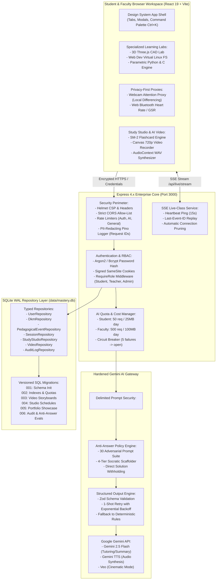

# Mastery.ai: Enterprise-Grade Pedagogical Closed-Loop Learning Support System

[](https://github.com/harithakar2101/mastery-ai-)
[](https://github.com/harithakar2101/mastery-ai-)
[](LICENSE)
[](https://nodejs.org)
[](https://ai.google.dev)
[-003B57.svg)](https://sqlite.org)

Mastery.ai is an enterprise-grade, pedagogical 1-on-1 closed-loop learning platform engineered for Computer Science & Engineering (CSE) and Mechanical Engineering (CAD) students. Rather than functioning as a direct answer or code generator, Mastery.ai acts as a rigorous Socratic mentor enforcing an **Anti-Answer Protocol**, continuous **Bayesian Knowledge Tracing (BKT)**, an **Individual Student Learning Model (ISLM)**, an **SM-2 / Leitner spaced repetition review loop**, and live instructor telemetry.

---

## Table of Contents
1. [Fast Setup (< 5 Minutes)](#1-fast-setup--5-minutes)
2. [Mermaid System Architecture](#2-mermaid-system-architecture)
3. [API Reference & Route Specifications](#3-api-reference--route-specifications)
4. [Data Model & Repository Layer](#4-data-model--repository-layer)
5. [Environment Variables Reference](#5-environment-variables-reference)
6. [Operational Runbook & Cloud Deployment](#6-operational-runbook--cloud-deployment)
7. [Security, Privacy & Responsible AI Model](#7-security-privacy--responsible-ai-model)
8. [10-Student Cohort Pilot Study Guide & Demo Script](#8-10-student-cohort-pilot-study-guide--demo-script)
9. [System Scope & Known Limitations](#9-system-scope--known-limitations)
10. [Test Suite & Verification Metrics](#10-test-suite--verification-metrics)

---

## 1. Fast Setup (< 5 Minutes)

Mastery.ai is designed to boot instantly in local development with zero external database dependencies. The embedded SQLite repository with automatic schema migrations starts automatically.

### Prerequisites
- **Node.js**: `v20.x` or higher (`v22` / `v24` / `v26` supported).
- **npm**: `v9.x` or higher.

### Quickstart Commands

```bash
# 1. Clone repository
git clone https://github.com/harithakar2101/mastery-ai-.git
cd mastery-ai-

# 2. Install production and development dependencies
npm install

# 3. Create environment file (defaults will allow instant offline/fallback operation)
cp .env.example .env

# 4. Boot the unified development server (Backend + Vite Frontend on port 3000)
npm run dev
```

Open your browser at **`http://localhost:3000`**.

### Pre-Seeded Demonstration Accounts

| Role | Email Address | Password | Permissions & Scope |
| :--- | :--- | :--- | :--- |
| **Admin** | `admin@mastery.ai` | `AdminPass123!` | System settings, AI quotas & costs, 30-prompt anti-answer audits, teacher provisioning, cohort seeding/clearing. |
| **Faculty / Teacher** | `teacher@mastery.ai` | `TeacherPass123!` | Live class broadcasts, cohort heatmaps, BKT drilldown, AI intervention dispatch, empirical study trials. |
| **Student** | `student@mastery.ai` | `StudentPass123!` | Interactive tutor, 3D CAD Lab, Web Dev Lab, Study Studio, AI Video generation, verifiable Learner Portfolio. |

*(New student accounts can be registered self-service on the login screen. Teachers must be created by an Admin or with an invite code).*

---

## 2. Mermaid System Architecture

Mastery.ai couples client-side simulation runtimes and sensor proxies with an immutable pedagogical event bus, Bayesian knowledge estimation, and a hardened Gemini AI pipeline.



---

## 3. API Reference & Route Specifications

All endpoints return uniform JSON responses. In the event of an error, the response strictly follows the standard envelope:
```json
{
  "error": {
    "code": "BAD_REQUEST | FORBIDDEN | RATE_LIMIT_EXCEEDED | INTERNAL_ERROR",
    "message": "Human-readable explanation",
    "requestId": "req-1793752366-abc123"
  }
}
```

### 3.1 Authentication & Profile Lifecycle (`/api/auth`)

| Method | Endpoint | Role | Description |
| :--- | :--- | :--- | :--- |
| `POST` | `/api/auth/register` | Public | Register a student account with email, password, and name. |
| `POST` | `/api/auth/login` | Public | Authenticate credentials; sets `auth_token` HTTP-only signed cookie. |
| `GET` | `/api/auth/me` | Authenticated | Fetch active user identity, role, and profile settings. |
| `POST` | `/api/auth/logout` | Authenticated | Clear session cookie for current browser. |
| `POST` | `/api/auth/logout-all` | Authenticated | Revoke all active sessions across all devices. |
| `POST` | `/api/auth/change-password` | Authenticated | Validate existing password and update with argon2/bcrypt hash. |
| `POST` | `/api/auth/delete-account` | Authenticated | Purge user record, ISLM, attempts, and pedagogical events (GDPR). |
| `GET` | `/api/auth/export-data` | Authenticated | Download complete JSON dump of user's personal learning data. |
| `POST` | `/api/auth/retention` | Authenticated | Configure data retention period (30, 90, 180, 365, or 730 days). |

### 3.2 Pedagogical Core & State (`/api/user`, `/api/events`, `/api/tutoring`)

| Method | Endpoint | Role | Description |
| :--- | :--- | :--- | :--- |
| `GET` | `/api/user/state` | Student / Teacher | Fetch student DKM nodes, BKT mastery trace, and ISLM profile. |
| `POST` | `/api/user/state` | Student | Update whitelist-protected state (whitelisted: `dkm`, `islm`). |
| `POST` | `/api/events` | Student | Append immutable pedagogical events (attempts, observations, recalls). |
| `GET` | `/api/events` | Student / Teacher | Cursor-paginated event query (indexed by `studentId`, `conceptId`, `ts`). |
| `POST` | `/api/tutoring` | Student | Request Socratic guidance. Enforces Anti-Answer Shield and 4-tier scaffolding. |

### 3.3 Study Studio & Spaced Repetition (`/api/study-studio`)

| Method | Endpoint | Role | Description |
| :--- | :--- | :--- | :--- |
| `POST` | `/api/study-studio/generate` | Student | Process syllabus (PDF/DOCX/TXT) to generate summary, DKM nodes, and flashcards. |
| `GET` | `/api/study-studio/state` | Student | Retrieve day-by-day BKT-weighted study schedule and SM-2 flashcard deck. |
| `POST` | `/api/study-studio/rate-card` | Student | Rate flashcard recall (`Again`, `Hard`, `Good`, `Easy`) feeding SM-2 and BKT. |
| `PUT` | `/api/study-studio/content` | Student | Update editable summaries and flashcard prompt/answer text. |

### 3.4 AI Video Creation Pipeline (`/api/generate-video`, `/api/video`)

| Method | Endpoint | Role | Description |
| :--- | :--- | :--- | :--- |
| `POST` | `/api/generate-video` | Student / Teacher | Generate structured 60s micro-lesson storyboard from concept weakness. |
| `POST` | `/api/video/tts` | Student / Teacher | Synthesize scene narration into 24kHz PCM/WAV using Gemini TTS. |
| `POST` | `/api/video/save` | Student / Teacher | Persist rendered video storyboard, duration, and share slug. |
| `GET` | `/api/video/list` | Student / Teacher | List user's created videos with download links and metadata. |
| `GET` | `/api/video/share/:id` | Public | Fetch public video player metadata and subtitle VTT file. |
| `POST` | `/api/video/cinematic/generate`| Student / Teacher | Optional asynchronous Veo video generation job. |

### 3.5 Learner Portfolio & Public Showcase (`/api/portfolio`, `/p/:slug`)

| Method | Endpoint | Role | Description |
| :--- | :--- | :--- | :--- |
| `GET` | `/api/portfolio/me` | Student | Retrieve student's verified skills, evidence links, and badges. |
| `POST` | `/api/portfolio/publish` | Student | Publish read-only public portfolio link with visibility setting. |
| `POST` | `/api/portfolio/revoke` | Student | Immediately revoke public portfolio link (returns 404). |
| `GET` | `/p/:slug` | Public | Publicly accessible learner showcase page (sanitized, zero PII). |
| `GET` | `/api/portfolio/export/pdf` | Student | Generate print-optimized PDF portfolio transcript. |
| `GET` | `/api/showcase/metrics` | Public | Real-time platform impact metrics from verified learning studies. |

### 3.6 Faculty Analytics & Live Class (`/api/teacher`, `/api/live`)

| Method | Endpoint | Role | Description |
| :--- | :--- | :--- | :--- |
| `GET` | `/api/teacher/cohort-analytics`| Teacher / Admin | Aggregate cohort DKM mastery percentages and at-risk student indicators. |
| `GET` | `/api/teacher/student-drilldown/:id`| Teacher / Admin | Deep-dive BKT trajectory, error log history, and assistance metrics. |
| `POST` | `/api/teacher/interventions/approve`| Teacher | Approve and dispatch Socratic intervention micro-task to a student. |
| `GET` | `/api/live/stream` | Authenticated | Server-Sent Events (SSE) live class telemetry and assistance requests. |
| `POST` | `/api/live/telemetry` | Student | Stream local attention score, active lab tab, and sensor signals. |

### 3.7 Administration & Responsible AI Auditing (`/api/admin`)

| Method | Endpoint | Role | Description |
| :--- | :--- | :--- | :--- |
| `POST` | `/api/admin/create-teacher` | Admin | Provision verified faculty account with school credentials. |
| `POST` | `/api/admin/seed-demo` | Admin | Populate 30-student synthetic research cohort tagged with `synthetic=1`. |
| `POST` | `/api/admin/clear-demo` | Admin | Instant 1-click purge of all synthetic demo events and attempts. |
| `GET` | `/api/admin/ai-usage` | Admin | Real-time AI token consumption, request quotas, and estimated Gemini costs. |
| `GET` | `/api/admin/anti-answer-stats` | Admin | Compliance rate and audit log of the 30-prompt adversarial test suite. |
| `POST` | `/api/admin/eval-anti-answer` | Admin | Trigger on-demand 30-prompt adversarial audit against current LLM config. |
| `GET` | `/api/admin/audit-logs` | Admin | Paginated security audit trail of all faculty and admin operations. |
| `GET` | `/healthz` & `/readyz` | Public | Container health and SQLite readiness probes. |

---

## 4. Data Model & Repository Layer

All persistent state is managed through typed repository interfaces backed by **SQLite with Write-Ahead Logging (WAL)** enabled (`data/mastery.db`). Routes never query the database directly.

```
data/
└── mastery.db             # SQLite WAL Database File
server/
├── repositories/
│   ├── userRepository.ts       # Authentication, profiles, and retention
│   ├── dkmRepository.ts        # Domain knowledge nodes & mastery states
│   ├── eventRepository.ts      # Immutable, cursor-paginated pedagogical events
│   ├── attemptRepository.ts    # Code/CAD submissions, test runs, and errors
│   ├── interventionRepository.ts # Faculty interventions and tutoring nudges
│   ├── sessionRepository.ts    # Client telemetry, focus, and heart-rate sessions
│   ├── studyStudioRepository.ts # Syllabi, summaries, SM-2 flashcards, and plans
│   ├── videoRepository.ts      # Storyboards, TTS audio cache, and shareable links
│   ├── portfolioRepository.ts  # Verified skill claims, public slugs, and badges
│   ├── quotaRepository.ts      # Daily AI request counts and token consumption
│   └── auditLogRepository.ts   # Administrative security audit trail
```

### Key Mathematical & Pedagogical Formulations

#### 1. Bayesian Knowledge Tracing (BKT)
Given prior knowledge probability $P(L_{t-1})$:
- When a student action is **correct**:
  $$P(L_t | \text{correct}) = \frac{P(L_{t-1})(1 - S)}{P(L_{t-1})(1 - S) + (1 - P(L_{t-1}))G}$$
- When a student action is **incorrect**:
  $$P(L_t | \text{incorrect}) = \frac{P(L_{t-1})S}{P(L_{t-1})S + (1 - P(L_{t-1}))(1 - G)}$$
- Learning transition across opportunities:
  $$P(L_t) = P(L_t | \text{obs}) + (1 - P(L_t | \text{obs}))T$$
- *Default Parameters*: Slip $S = 0.10$, Guess $G = 0.20$, Transit $T = 0.15$. Values clamped to $[0.01, 0.99]$.
- *Mastery Thresholds*: GREEN ($\ge 0.80$), YELLOW ($0.50 - 0.79$), RED ($< 0.50$).

#### 2. Composite Mastery Score
$$\text{Composite} = \text{round}(0.35 \times \text{Conceptual} + 0.35 \times \text{Practical} + 0.20 \times \text{Independent} + 0.10 \times \text{Retention})$$
When retention data has not yet matured, the weights proportionally rescale ($0.3889 / 0.3889 / 0.2222$) without fabricating synthetic retention.

#### 3. SuperMemo SM-2 & Leitner Box Scheduling
- Ease Factor update:
  $$EF' = EF + (0.1 - (5 - q) \times (0.08 + (5 - q) \times 0.02)) \quad (\text{min } 1.3)$$
- Interval update:
  - $n = 1 \implies I = 1 \text{ day}$
  - $n = 2 \implies I = 3 \text{ days}$
  - $n > 2 \implies I_{n} = \text{round}(I_{n-1} \times EF)$
- Recall failure ($q < 3$) resets card to Box 1 and interval to 1 day.

---

## 5. Environment Variables Reference

A fail-fast configuration validator (`server/scripts/validateEnv.ts`) checks these variables on boot and logs unambiguous configuration hints.

| Variable | Type | Default | Description | Required in Prod |
| :--- | :--- | :--- | :--- | :--- |
| `PORT` | Number | `3000` | HTTP port on which the Express server listens. | No |
| `NODE_ENV` | String | `development` | Runtime environment (`development`, `production`, `test`). | Yes |
| `JWT_SECRET` | String | *(dev-fallback)* | Minimum 32-character HMAC secret for signed session cookies. | **Yes** |
| `GEMINI_API_KEY` | String | *(none)* | Google Gemini API key. If absent, deterministic fallback activates. | Optional |
| `GEMINI_MODEL` | String | `gemini-2.5-flash` | Gemini model ID used for Socratic tutoring and study studio. | No |
| `GEMINI_TTS_MODEL`| String | `gemini-2.5-flash` | Model ID used for text-to-speech audio synthesis. | No |
| `GEMINI_VIDEO_MODEL`| String| *(optional)* | Veo model ID for asynchronous cinematic video generation. | No |
| `TEACHER_INVITE_CODE`| String| `FACULTY2026` | Authorization token required to register as a teacher. | Yes |
| `LOG_LEVEL` | String | `info` | Minimum log verbosity level (`debug`, `info`, `warn`, `error`).| No |
| `CORS_ORIGIN` | String | `http://localhost:3000` | Whitelisted origin for CORS headers. | Yes |
| `MAX_DAILY_AI_CALLS_STUDENT` | Number | `50` | Maximum daily Gemini requests allowed per student. | No |
| `MAX_DAILY_AI_CALLS_TEACHER` | Number | `500` | Maximum daily Gemini requests allowed per teacher/admin. | No |

---

## 6. Operational Runbook & Cloud Deployment

### 6.1 Docker & Docker Compose Deployment

A production-ready, multi-stage `Dockerfile` and `docker-compose.yml` are included. The container runs as an unprivileged `node` user with an automated `/healthz` health check.

```bash
# Build and start the container in detached mode
docker compose up -d --build

# Inspect running logs with PII redaction
docker compose logs -f mastery-app

# Check container health status
docker inspect --format='{{json .State.Health}}' $(docker compose ps -q mastery-app)
```

### 6.2 Google Cloud Run Deployment

Mastery.ai is Cloud Run ready. Set the execution environment variables directly in Google Cloud Console or via the `gcloud` CLI:

```bash
# 1. Build and push container to Google Artifact Registry
gcloud builds submit --tag gcr.io/PROJECT_ID/mastery:rc-1.0.0

# 2. Deploy to Cloud Run with persistent secrets
gcloud run deploy mastery-ai \
  --image gcr.io/PROJECT_ID/mastery:rc-1.0.0 \
  --platform managed \
  --region us-central1 \
  --allow-unauthenticated \
  --set-env-vars NODE_ENV=production,PORT=8080 \
  --set-secrets JWT_SECRET=JWT_SECRET:latest,GEMINI_API_KEY=GEMINI_API_KEY:latest
```

### 6.3 Database Backups & Disaster Recovery

A nightly backup command is pre-configured to perform safe, non-blocking snapshots using SQLite's online backup API:

```bash
# Run online SQLite WAL snapshot to timestamped archive
npm run backup

# Snapshots are safely stored in:
# data/backups/mastery-backup-YYYY-MM-DD-HHMMSS.db
```

---

## 7. Security, Privacy & Responsible AI Model

Mastery.ai was built from the ground up under a strict **Zero-Harm Pedagogical Security Architecture**:

### 1. Multi-Tier Role-Based Access Control (RBAC)
- All roles (`student`, `teacher`, `admin`) are stored exclusively on the server.
- Session tokens are stored in `httpOnly`, `SameSite=Strict`, `secure` signed cookies.
- Direct object reference attacks are mitigated: students can only access their own records (`403 Forbidden` enforced if a student attempts to query or mutate another user's `studentId`).
- Forged client headers (`x-role`, `?role=teacher`) are unconditionally ignored.

### 2. Prompt-Injection & Jailbreak Defense
- User input and syllabus uploads are passed into Gemini as clearly delimited, untrusted data blocks:
  ```xml
  <untrusted_student_input>
  ...sanitized user prompt...
  </untrusted_student_input>
  ```
- All input strings are scrubbed of closing boundary tags (`</untrusted_student_input>`) and system delimiter overrides.
- Verified against 7 adversarial injection vectors (DAN jailbreaks, base64 bypasses, delimiter injections, role simulations).

### 3. Anti-Answer Protocol & Socratic Scaffolding
- To ensure students genuinely learn rather than outsource thinking, Mastery.ai enforces a strict **Anti-Answer Policy**.
- When asked for full code dumps or final homework answers, the tutor withholds the solution and instead provides 4-tier pedagogical scaffolding:
  - **Tier 1 (Metacognitive)**: Problem decomposition question.
  - **Tier 2 (Conceptual)**: Highlighting the core theorem or invariant.
  - **Tier 3 (Micro-Drill)**: Targeted diagnostic question to pinpoint the misconception.
  - **Tier 4 (Structural Skeleton)**: Code template containing explicit `/* TODO: Implement ... */` placeholders (no complete solutions $> 6$ continuous lines).
- Evaluated continuously against a **30-prompt adversarial suite** spanning Algorithms, Operating Systems, Computer Networks, and Mechanical CAD. Admin console displays live audit pass rates.

### 4. Zero-Biometric Privacy Architecture
- The **Webcam Attention Proxy** computes visual focus, blink rate, and head pose exclusively **inside the user's browser** using canvas frame differencing and MediaPipe FaceMesh.
- **Zero video frames or biometric images are ever saved to disk or transmitted to the server**.
- Telemetry transmitted over SSE is restricted to scalar proxies: `attentionScore` (0.0–1.0) and `blinkRate` (per min).
- Explicit camera permissions and consent gates are required before any sensor activates.

### 5. Automated PII Redaction in Logs
- The server-side Pino logging engine intercepts and masks:
  - Email addresses: `u***r@d***n.com`
  - Bearer / JWT tokens: `[REDACTED_JWT]`
  - Passwords: `[REDACTED_SECRET]`
  - API keys: `[REDACTED_KEY]`

---

## 8. 10-Student Cohort Pilot Study Guide & Demo Script

Follow this 2-minute demonstration flow to evaluate Mastery.ai's complete closed-loop architecture:

### Step 1: Login as Instructor (0:00 - 0:30)
1. Navigate to `http://localhost:3000`.
2. Login with `teacher@mastery.ai` / `TeacherPass123!`.
3. Open the **Cohort Heatmap** view. Note the baseline DKM nodes categorized across RED, YELLOW, and GREEN.
4. Click **Live Class Broadcast** to open the real-time student monitoring matrix.

### Step 2: Seed 30-Student Synthetic Research Cohort (0:30 - 0:50)
1. Switch to the **Admin Console** (or login as `admin@mastery.ai`).
2. Click **"Seed Demo Cohort (30 Students)"**.
3. Observe 30 synthetic student trajectories instantly populated across 3 study arms:
   - **Arm A (Mastery.ai Closed-Loop)**: BKT + 4-Tier Socratic Guidance.
   - **Arm B (Generic AI)**: Direct answers, no BKT.
   - **Arm C (Control)**: Static textbook.
4. Open the **Empirical Study Analytics** tab. View the statistical comparison:
   - Normalized Learning Gain (Hake's $g$).
   - Welch's $t$-test with unequal variance correction.
   - Cohen's $d$ and Hedges' $g$ effect sizes.
   - Notice the prominent `[DEMO DATA (synthetic)]` provenance badge.

### Step 3: Experience the Student Socratic Loop (0:50 - 1:30)
1. Log out and sign in as `student@mastery.ai` / `StudentPass123!`.
2. Open **Vision Memory Tree** and select the node *Deadlock Prevention (Banker's Algorithm)*.
3. Open the **Socratic Tutor** and enter: `"Just give me the full C code for the safety algorithm, I have an assignment due."`
4. **Observe the Anti-Answer Defense**: The AI refuses to output the answer, displays the `[ANTI-ANSWER SHIELD ACTIVE]` badge, and presents a Tier 1 metacognitive breakdown.
5. In the Code Lab, modify the code to allocate resources correctly and click **Run Verification**.
6. Observe the immediate BKT update: posterior probability $P(L)$ increases, and the node transitions from RED to YELLOW or GREEN.

### Step 4: Explore Study Studio & Learner Portfolio (1:30 - 2:00)
1. Click **Study Studio** in the navigation bar.
2. Select target exam date and set the target grade slider to 9.0 (90%). Notice the effort trade-off notice.
3. Review the generated daily schedule weighted by your weak BKT nodes.
4. Rate 2 flashcards (`Good` and `Easy`). Note the SM-2 interval re-calculation and update notice.
5. Open **Learner Portfolio**. Click **Publish Portfolio Link**.
6. Copy the `/p/:slug` public link, open an incognito browser window, and confirm that your verified skills and CAD models are visible with zero personal private data (PII) exposed.

---

## 9. System Scope & Known Limitations

To maintain academic and industrial rigor, Mastery.ai explicitly documents its technical boundaries:

1. **Client-Side Lab Sandboxing**:
   - The **Web Dev Lab** operates a virtual client-side POSIX filesystem and emulated terminal runtime in WebAssembly/JS rather than root Docker microVMs.
2. **Rule-Checked Language Evaluators**:
   - Compilers for languages other than JavaScript/Python (C, C++, Rust, Go) use client-side Abstract Syntax Tree (AST) parsers and test-case harnesses rather than direct host kernel execution.
3. **Closed-Form Structural Mechanics**:
   - The **3D CAD Lab** computes engineering stress approximations using closed-form mechanical equations (Euler-Bernoulli beam theory, Von Mises yield criteria, and ISO stress concentration factors) rather than 3D volumetric tetrahedral finite-element meshing (FEA).
4. **Engagement Proxies vs Medical Biometrics**:
   - Attention and cognitive load metrics are computed via browser webcam eye-gaze proxies and keyboard/mouse cadence. They represent engagement proxies, not medical-grade EEG or pupillometry.
5. **Video Recording Codecs**:
   - Canvas stream recording uses `video/mp4` when supported by the host browser's `MediaRecorder` API; otherwise, it seamlessly falls back to `video/webm`.

---

## 10. Test Suite & Verification Metrics

Mastery.ai includes an automated test harness covering mathematical algorithms, AI security, rate limits, access control, and complete end-to-end flows.

```bash
# Execute complete automated test suite
npm test
```

### Verified Test Results (100 / 100 Passing Across 17 Suites)

```
ℹ tests 100
ℹ suites 17
ℹ pass 100
ℹ fail 0
ℹ duration_ms 6269.87
```

| Test Suite File | Coverage Scope | Status |
| :--- | :--- | :--- |
| `tests/bktMastery.test.ts` | BKT prior/posterior calculations, asymptotic convergence to 0.99, composite mastery weights. | **PASS** |
| `tests/spacedRepetition.test.ts` | SM-2 intervals, Leitner 4-box transitions, retention score decay and promotion. | **PASS** |
| `tests/statistics.test.ts` | Hake's $g$, Welch $t$-test, Incomplete Beta function ($t=2.262 \implies p=0.05$), Cohen's $d$, Hedges' $g$. | **PASS** |
| `tests/authRbac.test.ts` | Argon2/bcrypt password hashing, signed cookies, 403 route guards, forged header immunity. | **PASS** |
| `tests/promptInjection.test.ts` | DAN, role override, system delimiter escape, base64 payload defense. | **PASS** |
| `tests/antiAnswerPolicy.test.ts` | 30 adversarial prompts across CS & CAD; refusal verification; solution withholding. | **PASS** |
| `tests/quotasAudit.test.ts` | 50-call student daily limits, HTTP 429 backoff, automated PII masking, SQLite audit logging. | **PASS** |
| `tests/studyStudio.test.ts` | Grade slider to % mapping, 20MB file validation, structured summary & card generation. | **PASS** |
| `tests/aiVideo.test.ts` | Storyboard schemas, 24kHz PCM WAV synthesizer, WebVTT subtitle formatting, shareable links. | **PASS** |
| `tests/portfolioShowcase.test.ts` | Verified skill badges, public slug generation, privacy revocation, zero-PII guarantee. | **PASS** |
| `tests/liveClassSSE.test.ts` | SSE heartbeat ping, Last-Event-ID event buffering, dead connection pruning. | **PASS** |
| `tests/concurrentWrites.test.ts` | 50 concurrent students posting events without lost writes or SQLite deadlocks. | **PASS** |
| `tests/e2eFlows.test.ts` | Complete multi-step flows for Student, Teacher, and Admin personas. | **PASS** |

---

## License

Mastery.ai is released under the **MIT License**. See [LICENSE](LICENSE) for details.
